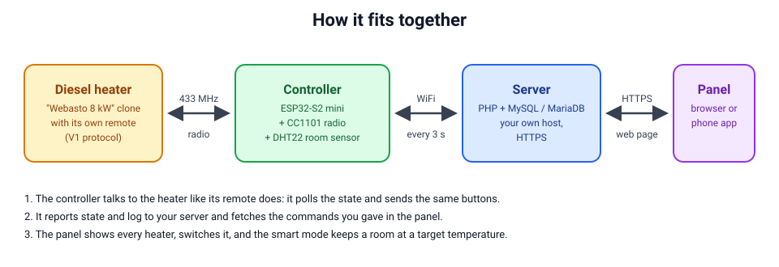
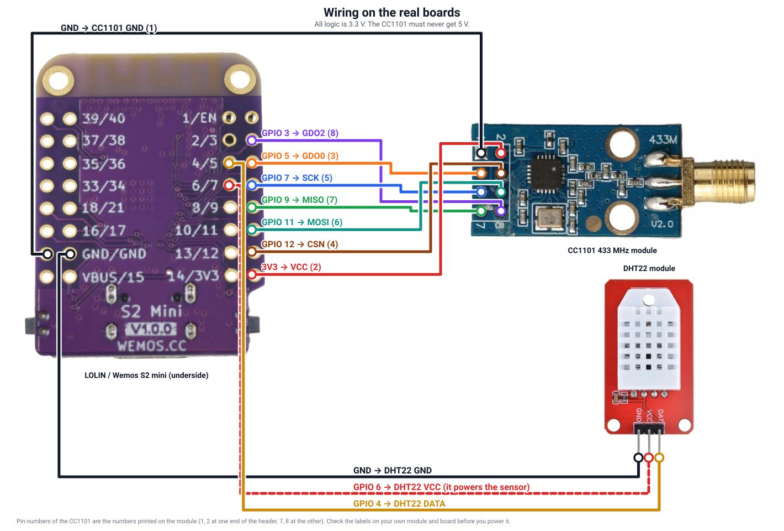

# Hardware: parts and wiring

## Parts

| Part | Qty | Notes |
| --- | --- | --- |
| **LOLIN (Wemos) S2 mini** | 1 | ESP32-S2FN4R2: 4 MB flash and **2 MB PSRAM**. The firmware needs both (the TLS buffers live in the PSRAM, an update needs two slots of 1.25 MB). Other ESP32 boards are not supported without changes to the pins and the partition table. |
| **CC1101 module, 433 MHz version** | 1 | The radio. Use a module tuned for **433 MHz** (many cheap boards are built for 868 or 915 MHz and then work badly at 433.9 MHz). The pinout below is that of the common 8-pin, 1.27 mm pitch module (E07-M1101D type); modules with 2.54 mm headers differ, so follow the pin names. 3.3 V only. |
| **Antenna for 433 MHz** | 1 | A helical spring or a SMA whip antenna. A quarter wave wire of **17.3 cm** works for a first test. Keep it away from metal. |
| **DHT22 (AM2302) on a 3-pin breakout** | 1 | The room thermometer and hygrometer: needed for **smart mode** and for the room chart. The breakout has the pull-up resistor on board. Optional if you only want to switch the heater. |
| 1.27 mm to 2.54 mm adapter board | 1 | Only when your CC1101 module has 1.27 mm pins and you want to use jumper wires; otherwise solder thin wires directly. |
| Jumper wires or solder + thin wire | ~14 | Keep the SPI wires short (under 15 cm). |
| USB-C cable and a 5 V power supply, 1 A or more | 1 | A good phone charger is fine. A weak supply that sags when the radio transmits causes dropouts (the console command `wifitx` lowers the WiFi power if you have to live with one). |
| Plastic enclosure | optional | Not metal: it would screen the antenna. |
| 100 µF capacitor across 3V3 and GND at the CC1101 | optional | Helps with the transmit bursts on a noisy supply. |

Each part costs a few euros. No mains wiring is involved: the controller talks
to the heater over radio, like its remote does, and needs only USB power.

## Wiring

The S2 mini is shown from its **underside**, the side with the pin names printed on it (two rows of holes on each side; the
outer row is the one at the edge of the board, GPIO 4 and 6 are in the inner row). The CC1101 is turned on its side, its
header is the two columns of four holes marked 1, 2 ... 7, 8. The tables give the same connections in text.

| CC1101 pin | S2 mini | Wire |
| --- | --- | --- |
| 1 GND | GND | black |
| 2 VCC | 3V3 | red |
| 3 GDO0 | GPIO 5 | orange |
| 4 CSN | GPIO 12 | brown |
| 5 SCK | GPIO 7 | blue |
| 6 MOSI | GPIO 11 | teal |
| 7 MISO | GPIO 9 | green |
| 8 GDO2 | GPIO 3 | violet |

| DHT22 pin | S2 mini |
| --- | --- |
| VCC | GPIO 6 (the controller powers the sensor from this pin, so it can power-cycle it when it hangs) |
| DATA | GPIO 4 |
| GND | GND |

The BOOT button (GPIO 0) and the LED (GPIO 15) are on the board and need no wiring. The pins are defined at the top of
`sniffer/sniffer.ino` (radio) and `sniffer/control.cpp` (DHT22); change them there if you wire it differently.

The pin numbers of the CC1101 are those printed on the common module shown above. Modules from other makers have another
pinout: go by the names (GND, VCC, GDO0, CSN, SCK, MOSI, MISO, GDO2), not by the numbers. The picture is drawn by
[`tools/make-wiring-figure.py`](../../tools/make-wiring-figure.py) from the photos in `photos/`.

## Check it

1. Flash the firmware over USB, open the serial monitor at 115200 baud. A working radio prints `CC1101 VERSION=0x14`
   (`CC1101 not found` means a wiring fault: check SCK, MOSI, MISO, CSN and the supply).
2. Put the controller within a few metres of the heater and run `heater1 30`, then press a button of the heater's own remote:
   frames with the address of your remote should appear. The setup portal's *find the remote automatically* does the same.
3. The CC1101 and the heater's electronics must never be powered from the heater's 12 V or 24 V supply directly. If you want
   to use it, put a proper buck converter (to 5 V) in between.

Read [../safety.md](../safety.md) before you let the controller start a heater.
